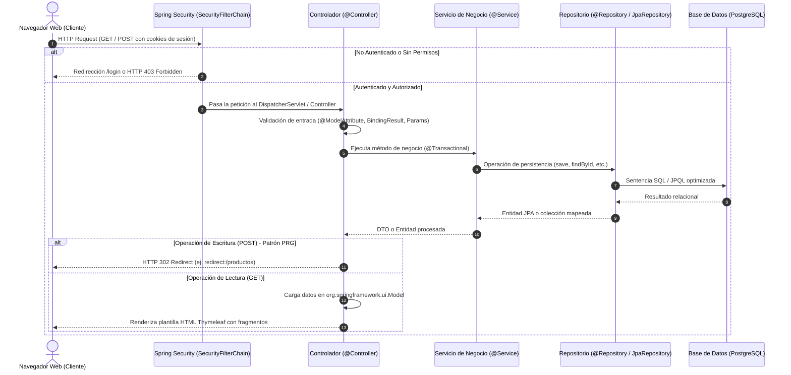

# Guía Técnica de Exposición Grupal: POS-MilleniumGames
**Arquitectura Modular por Capas (Package by Feature) en Spring Boot 3 & Thymeleaf**

---

## Diagrama de Interacción General (Ciclo de Vida de una Petición CRUD)

El siguiente diagrama ilustra cómo interactúa el cliente web con la cadena de filtros de seguridad, el controlador correspondiente, la capa de servicio y la persistencia en PostgreSQL:



---

## Distribución de Temas por Integrante

```
+---------------+------------------------------------------------------------+
| Integrante    | Tema Asignado                                              |
+---------------+------------------------------------------------------------+
| Integrante 1  | El Flujo de Autenticación y Seguridad (Login & Session)    |
| Integrante 2  | Modelado del Dominio y Persistencia (JPA & PostgreSQL)     |
| Integrante 3  | Flujo Completo del Módulo de Empleados (Gestión Usuarios)  |
| Integrante 4  | Flujo Completo del Módulo de Inventario (Gestión Productos)|
| Integrante 5  | El Motor del Sistema (Registro Transaccional de Ventas)    |
| Integrante 6  | UI, Fragmentos, Modo Oscuro y Generación de Reportes       |
+---------------+------------------------------------------------------------+
```

---

### Integrante 1: El Flujo de Autenticación y Seguridad (Login)

- **Archivos a proyectar**:
  1. `src/main/java/com/umoar/posmilleniumgames/configuraciones/SecurityConfig.java`
  2. `src/main/java/com/umoar/posmilleniumgames/modulos/usuarios/servicios/UsuarioDetallesService.java`
  3. `src/main/java/com/umoar/posmilleniumgames/modulos/usuarios/servicios/UsuarioDetalles.java`
  4. `src/main/java/com/umoar/posmilleniumgames/modulos/usuarios/controladores/LoginController.java`
  5. `src/main/resources/templates/usuarios/login.html`

- **Conceptos técnicos a evaluar**:
  - **Anotaciones**: `@Configuration`, `@EnableWebSecurity`, `@Bean`, `@Service`, `@Controller`, `@GetMapping`.
  - **Patrones de diseño**:
    - *Filter Chain (Cadena de Responsabilidad)*: Ejecución secuencial de filtros HTTP de Spring Security.
    - *Adapter Pattern*: `UsuarioDetalles` adapta nuestra entidad de dominio `Usuario` a la interfaz `UserDetails` de Spring Security.
    - *Strategy Pattern*: `PasswordEncoder` desacopla el algoritmo de hashing (BCrypt).
  - **Mecanismos clave**: Autenticación basada en formularios (`formLogin`), protección CSRF automática en Thymeleaf, hashing irreversible con sal (`BCryptPasswordEncoder`), y roles con prefijo `ROLE_`.

- **Guion técnico paso a paso**:

  1. **Intercepción HTTP en la Cadena de Filtros (`SecurityConfig.java`)**:
     Explicar cómo Spring Security intercepta cada solicitud entrante antes de que llegue a los controladores mediante el bean `SecurityFilterChain`:
     ```java
     @Bean
     public SecurityFilterChain filterChain(HttpSecurity http) throws Exception {
         http
             .authorizeHttpRequests(authorize -> authorize
                 .requestMatchers("/css/**", "/js/**", "/images/**", "/uploads/**", "/webjars/**").permitAll()
                 .requestMatchers("/login", "/logout").permitAll()
                 .requestMatchers("/reportes/**", "/usuarios/**").hasRole("ADMIN")
                 .requestMatchers("/", "/dashboard", "/caja/**", "/productos/**").authenticated()
                 .anyRequest().authenticated()
             )
             .formLogin(form -> form
                 .loginPage("/login")
                 .loginProcessingUrl("/login")
                 .defaultSuccessUrl("/", true)
                 .permitAll()
             )
             .logout(logout -> logout
                 .logoutUrl("/logout")
                 .invalidateHttpSession(true)
                 .deleteCookies("JSESSIONID")
                 .logoutSuccessUrl("/login?logout")
                 .permitAll()
             );
         return http.build();
     }
     ```
     *Puntos clave a señalar*:
     - Los recursos estáticos y `/login` son de acceso libre (`permitAll()`).
     - Rutas críticas como `/usuarios/**` y `/reportes/**` exigen el rol `ADMIN`.
     - El cierre de sesión destruye la sesión HTTP y elimina la cookie `JSESSIONID`.

  2. **Cifrado de Contraseñas (`SecurityConfig.java`)**:
     Mostrar el bean del codificador:
     ```java
     @Bean
     public PasswordEncoder passwordEncoder() {
         return new BCryptPasswordEncoder();
     }
     ```
     Explicar que `BCryptPasswordEncoder` aplica un hash con salt aleatorio de 10 rondas por defecto, garantizando que ninguna contraseña se almacene en texto plano en PostgreSQL.

  3. **Carga y Autenticación del Usuario desde la Base de Datos (`UsuarioDetallesService.java`)**:
     Explicar la implementación de la interfaz fundamental `UserDetailsService`:
     ```java
     @Override
     public UserDetails loadUserByUsername(String username) throws UsernameNotFoundException {
         Usuario usuario = usuarioRepository.findByUsername(username)
                 .orElseThrow(() -> new UsernameNotFoundException("Usuario no encontrado con username: " + username));

         Collection<GrantedAuthority> authorities = usuario.getRoles().stream()
                 .map(rol -> new SimpleGrantedAuthority(rol.getNombre()))
                 .collect(Collectors.toList());

         return new UsuarioDetalles(usuario, authorities);
     }
     ```
     *Puntos clave a señalar*:
     - Se consulta al `UsuarioRepository` por el nombre de usuario único.
     - Cada entidad `Rol` asociada se transforma en un `SimpleGrantedAuthority` (ej. `ROLE_ADMIN`).
     - Se encapsula todo en la clase envoltorio `UsuarioDetalles`.

  4. **El Adaptador de Sesión (`UsuarioDetalles.java`)**:
     Mostrar cómo implementa los contratos de `UserDetails`:
     ```java
     public class UsuarioDetalles implements UserDetails {
         private final Usuario usuario;
         private final Collection<? extends GrantedAuthority> authorities;
         // Métodos: getUsername(), getPassword(), isEnabled(), getNombre()...
     }
     ```
     Esto permite que Spring Security verifique internamente las credenciales contra el hash almacenado y que el resto de la aplicación tenga acceso seguro a los atributos del usuario logueado.

  5. **Controlador y Vista de Login (`LoginController.java` y `login.html`)**:
     Mostrar el método del controlador:
     ```java
     @GetMapping("/login")
     public String mostrarLogin() {
         return "usuarios/login";
     }
     ```
     Y en la vista `login.html`, destacar el manejo de parámetros de estado enviados por Spring Security:
     ```html
     <div class="error" role="alert" th:if="${param.error}">Usuario o contraseña incorrectos</div>
     <div class="error" role="alert" th:if="${param.denied}">Tu cuenta no tiene permiso para acceder a esa sección.</div>
     <div class="success" role="alert" th:if="${param.logout}">Has cerrado sesión exitosamente.</div>

     <form th:action="@{/login}" method="post">
         <!-- Thymeleaf inyecta el token CSRF automáticamente en th:action -->
     ```

- **Transición**:
  > *"Ahora que comprendemos cómo Spring Security valida credenciales y gestiona la seguridad en memoria, cedo la palabra a mi compañero/a [Nombre Integrante 2], quien explicará cómo está estructurado el modelo relacional en la base de datos PostgreSQL, cómo se mapean las entidades con JPA/Hibernate y cómo se inicializan los datos del sistema con DataSeeder."*

---

### Integrante 2: Modelado del Dominio y Persistencia (Base de Datos)

- **Archivos a proyectar**:
  1. `src/main/java/com/umoar/posmilleniumgames/modulos/usuarios/modelos/Usuario.java`
  2. `src/main/java/com/umoar/posmilleniumgames/modulos/usuarios/modelos/Rol.java`
  3. `src/main/java/com/umoar/posmilleniumgames/modulos/inventario/modelos/Producto.java`
  4. `src/main/java/com/umoar/posmilleniumgames/modulos/ventas/modelos/Venta.java`
  5. `src/main/java/com/umoar/posmilleniumgames/configuraciones/DataSeeder.java`
  6. `src/main/java/com/umoar/posmilleniumgames/modulos/usuarios/repositorios/RolRepository.java`
  7. `src/main/java/com/umoar/posmilleniumgames/modulos/usuarios/repositorios/UsuarioRepository.java`

- **Conceptos técnicos a evaluar**:
  - **Anotaciones JPA / Hibernate**: `@Entity`, `@Table(name = "...")`, `@Id`, `@GeneratedValue(strategy = GenerationType.IDENTITY)`, `@Column`, `@ManyToMany`, `@JoinTable`, `@ManyToOne`, `@OneToMany`, `@JoinColumn`.
  - **Patrones de diseño**:
    - *Active Record / Data Mapper (ORM)*: Hibernate actúa como Data Mapper sincronizando objetos en Java con tablas de PostgreSQL.
    - *Repository Pattern*: `JpaRepository` desacopla la lógica de negocio del dialecto SQL nativo.
  - **Mecanismos clave**: Generación de identificadores autoincrementales, fetch types (`FetchType.EAGER` vs `FetchType.LAZY`), tipos numéricos precisos con `BigDecimal` y la ejecución en el ciclo de vida de la aplicación con `CommandLineRunner`.

- **Guion técnico paso a paso**:

  1. **Mapeo de Entidades Relacionales (`Usuario.java` y `Rol.java`)**:
     Explicar cómo se estructura la tabla de usuarios y la relación muchos a muchos con roles:
     ```java
     @Entity
     @Table(name = "usuarios")
     @Getter @Setter
     public class Usuario {
         @Id
         @GeneratedValue(strategy = GenerationType.IDENTITY)
         private Long id;

         @Column(unique = true, nullable = false)
         private String username;

         @Column(nullable = false)
         private String password;

         @Column(nullable = false)
         private String nombre;

         private boolean enabled = true;

         @ManyToMany(fetch = FetchType.EAGER)
         @JoinTable(
             name = "usuarios_roles",
             joinColumns = @JoinColumn(name = "usuario_id"),
             inverseJoinColumns = @JoinColumn(name = "rol_id")
         )
         private Set<Rol> roles = new HashSet<>();
     }
     ```
     *Puntos clave a señalar*:
     - `@Table(name = "usuarios")` especifica la tabla relacional en PostgreSQL.
     - `@JoinTable` crea la tabla intermedia `usuarios_roles`.
     - Se utiliza `FetchType.EAGER` para que al cargar el usuario para autenticación, sus roles estén disponibles inmediatamente en la sesión de Spring Security.

  2. **Modelado de Artículos e Inventario (`Producto.java`)**:
     Mostrar las relaciones ManyToOne en el catálogo:
     ```java
     @Entity
     @Table(name = "productos")
     @Getter @Setter
     public class Producto {
         @Id
         @GeneratedValue(strategy = GenerationType.IDENTITY)
         private Long id;

         @Column(unique = true, nullable = false)
         private String sku;

         @Column(nullable = false)
         private String nombre;

         @Column(nullable = false, precision = 10, scale = 2)
         private BigDecimal precio;

         @Column(nullable = false)
         private Integer stock;

         @ManyToOne(fetch = FetchType.LAZY)
         @JoinColumn(name = "categoria_id")
         private Categoria categoria;

         @ManyToOne(fetch = FetchType.LAZY)
         @JoinColumn(name = "plataforma_id")
         private Plataforma plataforma;
     }
     ```
     *Puntos clave a señalar*:
     - El precio usa `BigDecimal` con precisión monetaria (evita imprecisiones de redondeo asociadas con `double` o `float`).
     - Se usa `FetchType.LAZY` para evitar consultas innecesarias de categorías o plataformas si solo se leen datos escalares del producto.

  3. **Abstracción con Spring Data JPA (`UsuarioRepository.java`)**:
     Mostrar la potencia de `JpaRepository`:
     ```java
     public interface UsuarioRepository extends JpaRepository<Usuario, Long> {
         Optional<Usuario> findByUsername(String username);
         boolean existsByUsername(String username);
     }
     ```
     Explicar que Spring Data genera automáticamente las consultas SQL mediante *Query Methods* basados en la convención de nombres (`findByUsername`, `existsByUsername`), sin necesidad de escribir SQL a mano.

  4. **Sembrado Idempotente de Datos al Arrancar (`DataSeeder.java`)**:
     Mostrar cómo arranca el sistema con datos esenciales:
     ```java
     @Component
     public class DataSeeder implements CommandLineRunner {
         @Override
         public void run(String... args) throws Exception {
             crearRolSiNoExiste("ROLE_ADMIN");
             crearRolSiNoExiste("ROLE_CAJERO");

             if (!usuarioRepository.existsByUsername("admin")) {
                 Usuario admin = new Usuario();
                 admin.setUsername("admin");
                 admin.setPassword(passwordEncoder.encode("admin1234"));
                 admin.setNombre("Administrador del Sistema");
                 admin.setEnabled(true);

                 Optional<Rol> adminRol = rolRepository.findByNombre("ROLE_ADMIN");
                 adminRol.ifPresent(rol -> admin.getRoles().add(rol));

                 usuarioRepository.save(admin);
             }
         }
     }
     ```
     *Puntos clave a señalar*:
     - Implementa `CommandLineRunner`, lo que garantiza su ejecución en cuanto el contexto de Spring Boot termina de cargar.
     - Es **idempotente**: comprueba previamente si existen los roles y el usuario antes de insertarlos para no generar errores de clave primaria ni duplicados.

- **Transición**:
  > *"Con las entidades mapeadas en PostgreSQL y los datos base sembrados mediante DataSeeder, le doy paso a mi compañero/a [Nombre Integrante 3], quien expondrá cómo estos usuarios y empleados son administrados a través del ciclo completo de peticiones HTTP en el módulo de personal."*

---

### Integrante 3: Flujo Completo del Módulo de Empleados (Gestión de Usuarios)

- **Archivos a proyectar**:
  1. `src/main/java/com/umoar/posmilleniumgames/modulos/usuarios/controladores/UsuarioController.java`
  2. `src/main/java/com/umoar/posmilleniumgames/modulos/usuarios/servicios/UsuarioService.java`
  3. `src/main/java/com/umoar/posmilleniumgames/modulos/usuarios/servicios/UsuarioServiceImpl.java`
  4. `src/main/resources/templates/usuarios/formulario.html`
  5. `src/main/resources/templates/usuarios/lista.html`

- **Conceptos técnicos a evaluar**:
  - **Anotaciones**: `@Controller`, `@RequestMapping("/usuarios")`, `@GetMapping`, `@PostMapping`, `@PathVariable`, `@ModelAttribute`, `@RequestParam`.
  - **Patrones de diseño**:
    - *MVC (Model-View-Controller)*: Separación estricta entre la lógica de control, los datos y la interfaz gráfica.
    - *Post-Redirect-Get (PRG)*: Prevención de reenvío duplicado de formularios al pulsar F5.
    - *Service Layer Pattern*: Desacoplamiento entre la interfaz de servicio y su implementación (`UsuarioServiceImpl`).
    - *DTO (Data Transfer Object)*: Uso de la clase interna estática `UsuarioForm` para aislar el formulario web de la entidad de base de datos.
  - **Mecanismos clave**: `RedirectAttributes.addFlashAttribute`, inyección de `Authentication` para auditoría de sesión, validaciones manuales de negocio y protección de autoeliminación de cuentas de administrador.

- **Guion técnico paso a paso**:

  1. **Listado de Personal y Control de Sesión Activa (`UsuarioController.java`)**:
     Mostrar el método de consulta:
     ```java
     @GetMapping
     public String listar(Model model, Authentication authentication) {
         model.addAttribute("usuarios", usuarioService.listarUsuarios());
         model.addAttribute("usuarioActualId", usuarioActualId(authentication));
         return "usuarios/lista";
     }
     ```
     *Puntos clave a señalar*:
     - Se cargan los usuarios en el `Model`.
     - Se obtiene el ID del usuario en sesión (`usuarioActualId(authentication)`) para que en la vista no se permita borrar la propia cuenta.
     - Retorna la vista modular `"usuarios/lista"`.

  2. **Registro de Empleados y Patrón Post-Redirect-Get (`UsuarioController.java`)**:
     Mostrar cómo se procesa el formulario con `@ModelAttribute`:
     ```java
     @PostMapping("/guardar")
     public String guardar(@ModelAttribute("usuario") UsuarioForm form, Model model) {
         String error = validarForm(form, true);
         if (error != null) {
             model.addAttribute("error", error);
             prepararFormulario(model, form, false);
             return "usuarios/formulario";
         }
         if (usuarioService.existePorUsername(form.getUsername().trim())) {
             model.addAttribute("error", "Ese username ya está registrado.");
             prepararFormulario(model, form, false);
             return "usuarios/formulario";
         }

         Usuario usuario = new Usuario();
         usuario.setUsername(form.getUsername().trim());
         usuario.setNombre(form.getNombre().trim());
         usuario.setPassword(passwordEncoder.encode(form.getPassword()));
         usuario.setEnabled(true);

         Optional<Rol> rolOpt = rolRepository.findByNombre("ROLE_" + form.getRol().toUpperCase());
         rolOpt.ifPresent(rol -> usuario.getRoles().add(rol));

         usuarioService.guardar(usuario);
         return "redirect:/usuarios"; // Patrón PRG
     }
     ```
     *Puntos clave a señalar*:
     - Si hay un error de validación, se devuelve la vista `"usuarios/formulario"` conservando los campos ingresados.
     - Si la validación es exitosa, se guarda la entidad y se responde con `redirect:/usuarios`. Esto envía una respuesta HTTP 302 que fuerza al navegador a realizar una petición `GET`, evitando que un refresco de pantalla vuelva a insertar al usuario en la base de datos.

  3. **Edición Segura de Empleados (`UsuarioController.java`)**:
     Mostrar la lógica en `@PostMapping("/actualizar/{id}")`:
     - Se valida que el nuevo username no colisione con el de otro usuario existente:
       ```java
       boolean usernameEnUso = usuarioService.buscarPorUsername(username)
               .filter(otroUsuario -> !Objects.equals(otroUsuario.getId(), id))
               .isPresent();
       ```
     - La actualización de contraseña es opcional: si el campo viene vacío, se conserva el hash anterior sin sobreescribirlo.

  4. **Protección de Negocio en la Eliminación (`UsuarioController.java`)**:
     Mostrar la restricción de seguridad:
     ```java
     @PostMapping("/eliminar/{id}")
     public String eliminar(@PathVariable Long id,
                            Authentication authentication,
                            RedirectAttributes redirectAttributes) {
         if (Objects.equals(usuarioActualId(authentication), usuario.getId())) {
             redirectAttributes.addFlashAttribute("error", "No puedes eliminar tu propia cuenta de administrador.");
             return "redirect:/usuarios";
         }
         usuarioService.eliminar(id);
         redirectAttributes.addFlashAttribute("mensaje", "Empleado eliminado correctamente.");
         return "redirect:/usuarios";
     }
     ```
     Aquí `RedirectAttributes.addFlashAttribute` almacena el mensaje temporalmente en la sesión para que sobreviva a la redirección HTTP y se muestre en el listado de usuarios.

  5. **Renderizado en la Vista (`usuarios/lista.html`)**:
     Mostrar cómo Thymeleaf renderiza los datos en la tabla:
     ```html
     <tr th:each="usuario : ${usuarios}">
         <td th:text="${usuario.username}"></td>
         <td th:text="${usuario.nombre}"></td>
         <td>
             <span th:each="rol : ${usuario.roles}" 
                   class="badge bg-primary-subtle text-primary" 
                   th:text="${rol.nombre.replace('ROLE_', '')}"></span>
         </td>
     ```

- **Transición**:
  > *"Comprendido el flujo MVC y el patrón Post-Redirect-Get en la administración de personal, cedo la palabra a mi compañero/a [Nombre Integrante 4], quien detallará el módulo de inventario, incluyendo la carga de imágenes, validaciones transaccionales y el catálogo interactivo de videojuegos."*

---

### Integrante 4: Flujo Completo del Módulo de Inventario (Gestión de Productos)

- **Archivos a proyectar**:
  1. `src/main/java/com/umoar/posmilleniumgames/modulos/inventario/controladores/ProductoController.java`
  2. `src/main/java/com/umoar/posmilleniumgames/modulos/inventario/servicios/ProductoService.java`
  3. `src/main/java/com/umoar/posmilleniumgames/modulos/inventario/modelos/Categoria.java`
  4. `src/main/java/com/umoar/posmilleniumgames/modulos/inventario/modelos/Producto.java`
  5. `src/main/resources/templates/inventario/formulario.html`
  6. `src/main/resources/templates/inventario/lista.html`

- **Conceptos técnicos a evaluar**:
  - **Anotaciones**: `@Controller`, `@RequestMapping("/productos")`, `@Transactional`, `@Transactional(readOnly = true)`, `@RequestParam`, `@ModelAttribute`.
  - **Patrones de diseño**:
    - *Transaction Script / Service Layer*: `ProductoService` concentra las reglas de negocio (precios no negativos, stock suficiente).
    - *Dependency Injection*: Inyección de dependencias en constructores para `ProductoService`, `CategoriaService` y `PlataformaService`.
  - **Mecanismos clave**: Tratamiento de archivos multipart (`MultipartFile`), validación de tipos MIME y tamaño de imagen, generación de identificadores únicos con `UUID`, funciones utilitarias de Thymeleaf (`#numbers.formatDecimal`) e iteración con `th:each`.

- **Guion técnico paso a paso**:

  1. **Búsqueda y Catálogo de Inventario (`ProductoController.java`)**:
     Mostrar el método de consulta con filtro:
     ```java
     @GetMapping
     public String listarProductos(@RequestParam(name = "buscar", required = false) String buscar, Model model) {
         if (buscar != null && !buscar.trim().isEmpty()) {
             model.addAttribute("productos", productoService.buscarPorNombre(buscar));
             model.addAttribute("buscar", buscar);
         } else {
             model.addAttribute("productos", productoService.obtenerTodos());
         }
         return "inventario/lista";
     }
     ```
     Explicar cómo se pasa el parámetro `buscar` opcional a la capa de servicio y se retorna la vista modular `"inventario/lista"`.

  2. **Reglas de Negocio en la Capa de Servicio (`ProductoService.java`)**:
     Mostrar las validaciones antes de persistir:
     ```java
     @Transactional
     public Producto guardar(Producto producto) {
         if (producto.getPrecio() == null || producto.getPrecio().compareTo(BigDecimal.ZERO) < 0) {
             throw new IllegalArgumentException("El precio no puede ser negativo.");
         }
         if (producto.getStock() == null || producto.getStock() < 0) {
             throw new IllegalArgumentException("El stock no puede ser inferior a cero.");
         }
         return productoRepository.save(producto);
     }
     ```
     Destacar que `@Transactional` asegura que la operación se ejecute dentro de un contexto de transacción en PostgreSQL. Si una validación falla, se lanza una excepción y la transacción se descarta.

  3. **Manejo y Validación de Imágenes en Disco (`ProductoController.java`)**:
     Explicar la lógica de subida segura de carátulas:
     ```java
     if (archivoImagen != null && !archivoImagen.isEmpty()) {
         if (!isValidImageFile(archivoImagen)) {
             throw new IllegalArgumentException("Solo se permiten archivos de imagen (JPG, PNG, WEBP).");
         }
         if (archivoImagen.getSize() > MAX_FILE_SIZE) {
             throw new IllegalArgumentException("El archivo no debe exceder 3MB.");
         }

         String nombreArchivo = UUID.randomUUID() + extension;
         Path directorioUploads = Paths.get(UPLOADS_DIR);
         // Guardado físico del stream en disco con Files.copy()
         producto.setImagen(nombreArchivo);
     } else if (producto.getId() != null) {
         // Si es edición y no se envió nueva foto, conserva la anterior
         Producto productoExistente = productoService.obtenerPorId(producto.getId());
         producto.setImagen(productoExistente.getImagen());
     }
     ```
     *Puntos clave a señalar*:
     - Se valida el MIME type (`image/jpeg`, `png`, `webp`) y el tamaño máximo (3MB).
     - Se renombra el archivo con un `UUID` para evitar colisiones de nombres o problemas de caracteres especiales en el sistema de archivos.

  4. **Renderizado en Plantilla Thymeleaf (`inventario/lista.html`)**:
     Mostrar cómo Thymeleaf renderiza los precios, stock y badges dinámicos:
     ```html
     <tr th:each="producto : ${productos}">
         <td>
             
         </td>
         <td th:text="${producto.sku}"></td>
         <td th:text="${producto.nombre}"></td>
         <td th:text="${'$' + #numbers.formatDecimal(producto.precio, 1, 'POINT', 2, 'POINT')}"></td>
         <td>
             <span th:class="${producto.stock > 5 ? 'badge bg-success-subtle text-success' : (producto.stock > 0 ? 'badge bg-warning-subtle text-warning-emphasis' : 'badge bg-danger-subtle text-danger')}"
                   th:text="${producto.stock + ' unids.'}"></span>
         </td>
     ```
     Destacar el uso de expresiones condicionales de clase para alertar visualmente si un producto está por agotarse o agotado.

- **Transición**:
  > *"Con el catálogo de productos cargado y sus existencias bajo control transaccional, es momento de analizar el corazón del sistema POS: la generación de tickets y cobro de ventas. Cedo la palabra a mi compañero/a [Nombre Integrante 5] para explicar la capa transaccional de ventas."*

---

### Integrante 5: El Motor del Sistema (Registro de Ventas)

- **Archivos a proyectar**:
  1. `src/main/java/com/umoar/posmilleniumgames/modulos/ventas/modelos/Venta.java`
  2. `src/main/java/com/umoar/posmilleniumgames/modulos/ventas/modelos/DetalleVenta.java`
  3. `src/main/java/com/umoar/posmilleniumgames/modulos/ventas/modelos/Cliente.java`
  4. `src/main/java/com/umoar/posmilleniumgames/modulos/ventas/repositorios/VentaRepository.java`
  5. `src/main/java/com/umoar/posmilleniumgames/modulos/inventario/servicios/ProductoService.java`

- **Conceptos técnicos a evaluar**:
  - **Anotaciones JPA / Spring**: `@Entity`, `@OneToMany(mappedBy = "venta", cascade = CascadeType.ALL, orphanRemoval = true)`, `@ManyToOne`, `@Transactional`, `@Query`, `@Param`.
  - **Patrones de diseño**:
    - *Aggregate Root (Domain-Driven Design)*: `Venta` actúa como raíz de agregación; sus `DetalleVenta` no existen de forma independiente.
    - *Unit of Work*: Gestionado por el `EntityManager` de Hibernate dentro del límite transaccional.
  - **Mecanismos clave**:
    - **Atomicidad (Propiedades ACID)**: Descontar stock y registrar la factura deben ocurrir como una sola unidad indivisible.
    - **Inmutabilidad histórica de precios**: Guardar el `precioUnitario` en cada `DetalleVenta`.
    - **Consultas optimizadas (Evitar el problema N+1)**: Uso de `left join fetch` en JPQL.

- **Guion técnico paso a paso**:

  1. **Estructura Maestro-Detalle (`Venta.java` y `DetalleVenta.java`)**:
     Explicar cómo se estructura una venta:
     ```java
     @Entity
     @Table(name = "ventas")
     public class Venta {
         @Id
         @GeneratedValue(strategy = GenerationType.IDENTITY)
         private Long id;

         @Column(unique = true, nullable = false)
         private String numeroFactura;

         @Column(nullable = false)
         private LocalDateTime fechaHora;

         @Column(nullable = false, precision = 10, scale = 2)
         private BigDecimal total;

         @Column(nullable = false)
         private String metodoPago;

         @ManyToOne(fetch = FetchType.LAZY)
         @JoinColumn(name = "cliente_id")
         private Cliente cliente;

         @ManyToOne(fetch = FetchType.LAZY)
         @JoinColumn(name = "usuario_id")
         private Usuario usuario;

         @OneToMany(mappedBy = "venta", cascade = CascadeType.ALL, orphanRemoval = true)
         private List<DetalleVenta> detalles = new ArrayList<>();
     }
     ```
     *Puntos clave a señalar*:
     - `cascade = CascadeType.ALL`: Al persistir una `Venta`, Hibernate guarda automáticamente todas sus líneas de `DetalleVenta`.
     - `orphanRemoval = true`: Si se retira un detalle de la lista, Hibernate elimina la fila huérfana de la base de datos.

  2. **Inmutabilidad de Línea de Venta (`DetalleVenta.java`)**:
     Mostrar los atributos de cada línea:
     ```java
     @Entity
     @Table(name = "detalles_venta")
     public class DetalleVenta {
         @ManyToOne(fetch = FetchType.LAZY)
         @JoinColumn(name = "venta_id", nullable = false)
         private Venta venta;

         @ManyToOne(fetch = FetchType.LAZY)
         @JoinColumn(name = "producto_id", nullable = false)
         private Producto producto;

         private Integer cantidad;

         @Column(nullable = false, precision = 10, scale = 2)
         private BigDecimal precioUnitario;

         @Column(nullable = false, precision = 10, scale = 2)
         private BigDecimal subtotal; // cantidad * precioUnitario
     }
     ```
     *Pregunta técnica clave*: ¿Por qué guardar `precioUnitario` en lugar de leer siempre `producto.getPrecio()`?
     *Respuesta*: Si dentro de un año el videojuego sube de precio en el inventario, los registros contables y facturas del pasado deben conservar exactamente el precio cobrado en ese instante.

  3. **Control Transaccional de Stock (`ProductoService.java`)**:
     Mostrar cómo el servicio descuenta stock de manera atómica:
     ```java
     @Transactional
     public void descontarStock(Long id, int cantidad) {
         if (cantidad <= 0) {
             throw new IllegalArgumentException("La cantidad a descontar debe ser mayor a cero.");
         }
         Producto producto = obtenerPorId(id);
         if (producto.getStock() < cantidad) {
             throw new IllegalStateException("Stock insuficiente para el producto: " + producto.getNombre());
         }
         producto.setStock(producto.getStock() - cantidad);
         productoRepository.save(producto);
     }
     ```
     Explicar que al ejecutar este método dentro de una transacción global de venta, si cualquiera de los productos en el carrito no cuenta con stock suficiente, la excepción desencadena un `ROLLBACK` completo en PostgreSQL: ni se descuenta ningún stock previo ni se genera la factura.

  4. **Consultas Agregadas en `VentaRepository.java`**:
     Mostrar la solución al problema de rendimiento **N+1**:
     ```java
     @Query("select distinct v from Venta v " +
            "left join fetch v.cliente " +
            "left join fetch v.detalles d " +
            "left join fetch d.producto " +
            "where v.fechaHora >= :inicio and v.fechaHora < :fin " +
            "order by v.fechaHora desc")
     List<Venta> buscarVentasEntre(@Param("inicio") LocalDateTime inicio, @Param("fin") LocalDateTime fin);
     ```
     Explicar que `join fetch` le indica a JPA que traiga en una sola consulta SQL la venta, su cliente, sus detalles y los productos correspondientes, evitando que Hibernate lance decenas de consultas adicionales individuales al recorrer la lista.

- **Transición**:
  > *"Habiendo garantizado la consistencia transaccional y el almacenamiento seguro de las operaciones comerciales, cedo la palabra a mi compañero/a [Nombre Integrante 6], quien presentará el módulo visual, la reutilización de componentes con Thymeleaf, el sistema de modo oscuro y la reportería analítica del dashboard."*

---

### Integrante 6: UI, Fragmentos, Estilos y Generación de Reportes

- **Archivos a proyectar**:
  1. `src/main/java/com/umoar/posmilleniumgames/configuraciones/GlobalControllerAdvice.java`
  2. `src/main/resources/templates/fragments/header.html`
  3. `src/main/resources/templates/fragments/navbar.html`
  4. `src/main/resources/templates/fragments/sidebar.html`
  5. `src/main/resources/templates/fragments/footer.html`
  6. `src/main/resources/static/css/layout.css`
  7. `src/main/resources/static/js/theme-toggle.js`
  8. `src/main/java/com/umoar/posmilleniumgames/modulos/ventas/servicios/ReporteServiceImpl.java`
  9. `src/main/java/com/umoar/posmilleniumgames/modulos/ventas/controladores/HomeController.java`
  10. `src/main/resources/templates/ventas/reportes.html`

- **Conceptos técnicos a evaluar**:
  - **Anotaciones**: `@ControllerAdvice`, `@ModelAttribute`, `@DateTimeFormat`, `@RequestParam`, `@Service`.
  - **Patrones de diseño**:
    - *Composite View Pattern*: Modularización de layouts completos en fragmentos reutilizables (`fragments/`).
    - *Observer / Event Driven en JavaScript*: Escucha de eventos DOM (`DOMContentLoaded`, `click`) para la mutación del tema.
  - **Mecanismos clave**:
    - Inyección global de sesión mediante `@ControllerAdvice`.
    - Integración de Spring Security en Thymeleaf (`sec:authorize="hasRole('ADMIN')"`).
    - Prevención de FOUC (*Flash of Unstyled Content*) en modo oscuro con script en `<head>`.
    - Variables nativas CSS (CSS Custom Properties).
    - Cálculo de métricas temporales de negocio (ingresos diarios, ventas del mes, productos más vendidos).

- **Guion técnico paso a paso**:

  1. **Inyección Global de Contexto (`GlobalControllerAdvice.java`)**:
     Explicar cómo evitamos duplicar código en todos los controladores:
     ```java
     @ControllerAdvice
     public class GlobalControllerAdvice {
         private final UsuarioRepository usuarioRepository;

         @ModelAttribute("nombreUsuarioLogueado")
         public String nombreUsuarioLogueado(Authentication authentication) {
             if (authentication == null || !authentication.isAuthenticated() || "anonymousUser".equals(authentication.getPrincipal())) {
                 return "";
             }
             if (authentication.getPrincipal() instanceof UsuarioDetalles detalles) {
                 return detalles.getNombre();
             }
             return usuarioRepository.findByUsername(authentication.getName())
                     .map(Usuario::getNombre)
                     .orElse(authentication.getName());
         }
     }
     ```
     *Explicación*: Toda vista Thymeleaf del proyecto tiene disponible la variable `${nombreUsuarioLogueado}` sin que ningún controlador individual tenga que colocarla explícitamente en el `Model`.

  2. **Arquitectura de Fragmentos Thymeleaf (`templates/fragments/`)**:
     Mostrar cómo se ensambla la interfaz de usuario en `templates/ventas/reportes.html` o `templates/dashboard/index.html`:
     ```html
     <head th:replace="~{fragments/header :: header('Reportes')}"></head>
     <body>
         <div th:replace="~{fragments/sidebar :: sidebar}"></div>
         <div class="main-wrapper">
             <header th:replace="~{fragments/navbar :: navbar}"></header>
             <main> ... contenido específico del módulo ... </main>
             <footer th:replace="~{fragments/footer :: footer}"></footer>
         </div>
     </body>
     ```
     Y en `sidebar.html`, mostrar la autorización declarativa:
     ```html
     <!-- Enlace solo visible para Administradores -->
     <li sec:authorize="hasRole('ADMIN')">
         <a th:href="@{/reportes}" class="nav-link-item">
             <i class="bi bi-graph-up"></i>
             <span class="link-text">Reportes</span>
         </a>
     </li>
     ```

  3. **Arquitectura del Modo Oscuro/Claro (`layout.css` y `theme-toggle.js`)**:
     - En `layout.css`: Explicar el uso de Custom Properties conmutables:
       ```css
       :root {
           --enterprise-surface: #f8fafc;
           --enterprise-text: #1e293b;
           --enterprise-primary: #0d6efd;
       }
       [data-theme="dark"] {
           --enterprise-surface: #09090b;
           --enterprise-text: #fafafa;
           --enterprise-primary: #0C5CAB;
       }
       ```
     - En `header.html`: Explicar el script síncrono para evitar parpadeos:
       ```html
       <script>
           (function() {
               var theme = localStorage.getItem("theme");
               if (theme === "dark") {
                   document.documentElement.setAttribute("data-theme", "dark");
               }
           })();
       </script>
       ```
     - En `theme-toggle.js`: Mostrar cómo el evento del botón conmuta el atributo en el elemento `<html>` y lo persiste en `localStorage`.

  4. **Cálculo de Métricas y Reportería Financiera (`ReporteServiceImpl.java` y `HomeController.java`)**:
     Mostrar cómo el controlador procesa los filtros de rango de fechas:
     ```java
     @GetMapping("/reportes")
     public String reportes(
             @RequestParam(required = false) @DateTimeFormat(iso = DateTimeFormat.ISO.DATE) LocalDate desde,
             @RequestParam(required = false) @DateTimeFormat(iso = DateTimeFormat.ISO.DATE) LocalDate hasta,
             Model model) {

         LocalDate hoy = LocalDate.now();
         desde = (desde == null) ? hoy.withDayOfMonth(1) : desde;
         hasta = (hasta == null) ? hoy : hasta;

         model.addAttribute("ventas", reporteService.buscarVentas(desde, hasta));
         model.addAttribute("ingresosPeriodo", reporteService.ingresosEntre(desde, hasta.plusDays(1)));
         model.addAttribute("cantidadVentas", reporteService.ventasEntre(desde, hasta.plusDays(1)));
         model.addAttribute("stockCritico", reporteService.productosConStockCritico());
         model.addAttribute("productosMasVendidos", reporteService.productosMasVendidos());
         return "ventas/reportes";
     }
     ```
     *Puntos clave a señalar*:
     - Se utiliza la convención semiabierta `[desde, hasta + 1 día)` para incluir todas las ventas del último día hasta las 23:59:59 sin desfases horarios.
     - Se muestran alertas de stock crítico (productos con 3 o menos existencias) y el ranking de productos más vendidos mediante la consulta de agregación `group by` en JPA.

- **Conclusión Técnica Grupal**:
  > *"Como hemos visto a lo largo de esta exposición, **POS-MilleniumGames** no solo cumple con las funciones operativas de un punto de venta para videojuegos, sino que implementa las mejores prácticas del ecosistema Spring Boot: seguridad por capas, modularidad por características ('Package by Feature'), transaccionalidad ACID, protección contra inyecciones y ataques CSRF, y una interfaz moderna, responsiva y adaptable con soporte de modo oscuro."*
